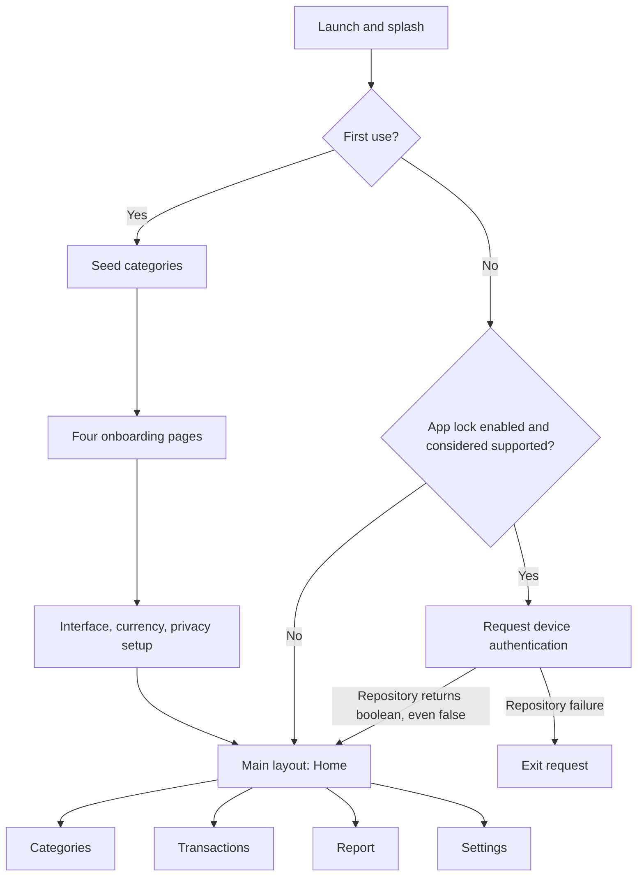
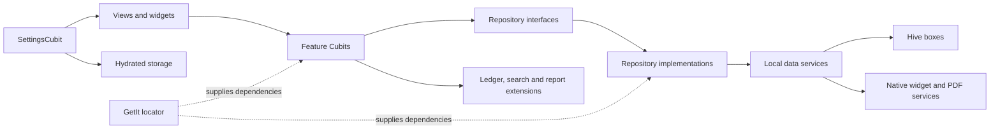

# Surrah

**A local personal finance tracker for recording income, understanding spending, and reviewing financial activity.**

Surrah is a Flutter application with Arabic and English interfaces, customizable transaction categories, a balance dashboard, and period-based financial reports. It stores financial records on the device using Hive and saves interface preferences with Hydrated BLoC. There is no account registration or application backend.

The product addresses the everyday task of keeping a manual record of money received and spent. Its intended audience, inferred from the implemented workflows, is individuals who want a personal ledger with category summaries and local control of their records.

This README describes the current working-tree implementation, including partially completed Android widget integration. Descriptions are verified from source; device behavior, release builds, and production availability have not been verified. App lock has an authentication-result handling defect, PDF export controls are hidden, and notifications are a preference only. See [Project status and limitations](#project-status-and-limitations).

## Contents

- [Product overview](#product-overview)
- [Screens and interaction surfaces](#screens-and-interaction-surfaces)
- [Features and business rules](#features-and-business-rules)
- [Navigation and user journeys](#navigation-and-user-journeys)
- [Design system](#design-system)
- [Technology stack](#technology-stack)
- [Architecture and initialization](#architecture-and-initialization)
- [Data and persistence](#data-and-persistence)
- [Project structure](#project-structure)
- [Installation and development](#installation-and-development)
- [Platforms and localization](#platforms-and-localization)
- [Project status and limitations](#project-status-and-limitations)
- [Verification and maintenance](#verification-and-maintenance)
- [License and credits](#license-and-credits)

## Product overview

| Area | Current implementation |
| --- | --- |
| Identity | Surrah; package `surrah`; version `1.0.0+2` |
| Category | Manual personal income and expense tracking |
| User model | One local user context; no login, profiles, administrator role, or shared accounts |
| Main navigation | Home, Categories, Transactions, Report, Settings |
| Financial records | Add/edit transactions with amount, category, date/time, and notes |
| Organization | Seeded/custom income and expense categories with editable names, icons, and colors |
| Discovery | Category-name search; transaction search by notes/category; type, category, and calendar-period filters |
| Reporting | Period totals, net balance, saved percentage, category breakdowns, and matching transactions |
| Preferences | Theme, language, global display currency, app-lock setting, screenshot protection, and widget settings |
| Storage | Local Hive records and serialized HydratedCubit preferences |
| Native targets | Android app and widget sources; Windows runner also present |

The ledger and report calculations use local data and do not require a server connection. Support links open external applications, and a conditional Android update check uses `in_app_update`. No banking connection, payment processing, exchange-rate API, cloud synchronization, analytics client, or remote authentication is implemented.

## Screens and interaction surfaces

### Startup and first use

| Screen | Purpose and visible content | Actions and destination |
| --- | --- | --- |
| Splash | Branded background/logo with fade, scale, and floating animations; startup category loading and optional device authentication | First use proceeds to onboarding; subsequent launches proceed through the authentication branch described below |
| Onboarding | Four illustrated pages introducing tracking, financial habits, savings goals, and financial control; expanding-dot indicator | Swipe or use Next; Skip jumps to the final introduction page; Get Started opens setup |
| Setup: interface | Light, dark, and system theme previews; Arabic/English choices with flags | Changes preferences immediately; Next opens currency setup |
| Setup: currency | Searchable currency list with name, code, symbol, flag, and selected state | Select global display currency; Next opens privacy setup |
| Setup: privacy | App-lock toggle when considered supported; screenshot-protection toggle; three-step progress indicator | Final action enters Home; close skips remaining setup and marks first use complete |

Setup contains three steps. Its final button remains labeled Next because the label checks an unreachable fourth-step index, although the third-step action does finish setup. Savings-goal wording in onboarding is introductory copy; there is no goal-management or savings-plan workflow.

### Main destinations

| Screen | Information and layout | Actions and state dependencies |
| --- | --- | --- |
| Home | Logo app bar; navy balance card with income/expense subtotals and circular remaining-ratio indicator; three colored quick actions; latest five transactions | Add income, add expense, or open add-category dialog; tap a transaction to edit. Reads `TransactionsCubit` |
| Categories | Search below app bar, filter action, four-column category grid, add floating button | Search name; filter all/income/expense; tap category to edit; add category. Add button is hidden during search/filtering. Uses `CategoriesCubit` |
| Transactions | Search/filter actions; cards with category icon/name, formatted date/time, signed colored amount | Search notes/category; filter type, categories, date period; tap to edit; floating button opens a form with type toggle. Uses `TransactionsCubit` |
| Report | Day/week/month/year selector; net-balance card with income, expense, saved percentage; spending/income breakdowns; matching transactions | Change period to fetch data; transaction rows open editing. Uses `ReportCubit`; share/download controls are excluded from visible widget tree |
| Settings | General settings and privacy/support groups with colored icons | Open theme, Languages, currency picker, Home Widget, Privacy Policy, Contact Support; toggle notification preference, app lock, screenshot protection. Uses `SettingsCubit` |

### Forms, secondary screens, dialogs, and sheets

| Surface | Content and behavior |
| --- | --- |
| Add/edit transaction | Full screen with back navigation, amount, optional type toggle, category, date/time, notes, save/update. Editing fills existing values. Successful writes pop the form and show a snackbar; failed writes show a failure snackbar |
| Add/edit category | Dialog with animated illustration, title/description, type selector, required name, icon/color preview, save/update, Cancel. Success closes the dialog, resets the form, and shows a snackbar; repository failures display a failure message |
| Category picker | Dialog with three-column category grid for the applicable type; selection returns a category to the transaction form |
| Icon/color picker | Searchable seven-column icon grid, color-name/hex preview, nested color picker. Selecting an icon returns it with the current color |
| Category filter | Bottom sheet with all/income/expense toggle, Apply, Cancel, and Clear when a filter is active |
| Transaction filter | Bottom sheet with type toggle, category multi-select chips, calendar-period tabs, Apply, Cancel, Clear. Category chips come from existing transactions |
| Theme | Dialog with light/dark/system choices; persisted changes rebuild the app theme |
| Languages | Dedicated Arabic/English selection screen; selection updates application locale |
| Currency picker | Searchable fiat-currency list, embedded in setup and shown as a bottom sheet from Settings |
| Home Widget | Preview, enable switch, balance visibility, and three shortcut switches. Details are dimmed/disabled when off; changes save and attempt a native update |
| Privacy Policy | Informational header and six cards about data, storage, sharing, security, deletion, policy updates. No data-management controls |
| Contact Support | Illustrations, email/website actions, four expandable FAQs, support footer. External-launch errors show snackbars; no in-app messaging/ticket system |

Shared lists provide Lottie empty/failure presentations and optional skeleton loading. Transaction lists pass a loading flag without placeholder records, so loading can appear blank. Report cards/analysis rows have skeleton handling; category grids have an empty state. Cubits emit fetch failures, but main category, transaction, and report bodies do not consistently display dedicated error/retry views.

## Features and business rules

### Transaction recording and balances

Home has separate income and expense entry paths. The Transactions floating button opens the same form with a type selector. Records store amount, category reference, selected timestamp, notes, and their own income/expense flag.

- Amount must be nonempty and accepted by `double.tryParse`. There is no explicit positive-only, nonzero, finite-value, or decimal-precision rule.
- Notes are outside the validated form and can be empty.
- Date/time defaults to now. The Omni picker receives no explicit business-specific date bounds.
- Category names require non-whitespace text; no uniqueness or explicit maximum-length rule is enforced.
- New category/transaction IDs use the current milliseconds-since-epoch as strings.
- Transactions are stored newest first by selected `createdAt`. Editing removes the old item and reinserts its replacement in timestamp order.
- Saving updates both records and aggregate balance. Editing reverses the old contribution before applying the replacement.

```text
totalIncome  = accumulated amounts of transactions marked income
totalExpense = accumulated amounts of transactions marked expense
balance      = totalIncome - totalExpense
expenseRatio = income <= 0 ? 0 : clamp(expense / income, 0, 1)
homeIndicatorPercentage = (1 - expenseRatio) * 100
```

The Home indicator shows 100% when income is zero and cannot represent overspending beyond a fully consumed ratio. It is not a configurable budget or savings goal.

Changing the general add-form type toggle changes category choices, but save still uses the view's original `isIncome` argument. That route starts as income, so choosing expense can save an income-marked record with an expense category. Editing changes amount, notes, category, and date while preserving the original income/expense flag. The separate Home income/expense paths do not expose this type toggle.

### Categories

First launch seeds six income categories—salary, freelance work, business, investment, gifts, other income—and nine expense categories—housing, food, transport, shopping, health, education, entertainment, bills, subscriptions. Stored default names are Arabic, regardless of interface locale.

Users can add/edit name, classification, icon, and color. Transactions reference category IDs, so existing records display current category names/colors. The Hive helper finds existing category IDs before updating, including records originally stored under auto-increment keys.

The full category list loads from Hive, but income/expense picker lists start from static defaults and are not rebuilt from restored data. Custom categories can disappear from transaction pickers after restart. Transaction edit initialization also searches `DefaultCategories.all`, so editing a record with a custom category can throw. Custom-category workflows should not be represented as fully reliable.

The icon picker also casts its returned icon/color to non-null values without handling dialog dismissal, so cancellation can produce an exception.

### Search and filters

Transaction search trims/lowercases the query and matches notes or current category names. Category search is a case-insensitive name substring match. New queries search the filtered collection when filtering is active. Type, selected categories, and date conditions are combined; selecting no category chips leaves membership unrestricted.

Transaction periods are today, yesterday, current week, current month, and current year. Filters use local device time. Weeks run Monday midnight up to, but excluding, next Monday. Month/year refer to the current calendar period, not trailing 30/365-day windows. Reports omit yesterday. The default selected period is today.

Search and filter results are separate stored lists. Applying/clearing filters does not reliably recompute an active search, which can leave stale or empty results. Bottom-navigation actions reset category/transaction search/filter state; swiping pages changes the index without the same reset actions.

### Reports and export infrastructure

Reports read persisted transactions and derive period totals. Report classification uses the **current category's type**, whereas Home balance uses the **transaction's own income/expense flag**. Category reclassification or the general-form type-toggle defect can therefore cause different totals.

Each income/expense group is aggregated by category ID and sorted by descending amount. Analysis cards show colors, amounts, percentages, and horizontal segments. Segment flex is proportional share plus a small fixed offset, so bars approximate proportions. These are standard Flutter widgets, not `fl_chart` charts.

```text
reportNetBalance = periodIncome - periodExpense
savedPercentage  = periodIncome == 0 ? 0 : reportNetBalance / periodIncome * 100
categoryShare    = groupTotal == 0 ? 0 : categoryAmount / groupTotal * 100
```

Saved percentage is not clamped and may be negative. Reports fetch on view construction and period changes; they do not subscribe directly to every transaction mutation, so a retained report can become stale after editing.

An A4 PDF builder embeds Cairo fonts and builds balance, analysis, and transaction sections. Service code opens the system print/Save as PDF dialog or share sheet with `report.pdf`. The widget containing export buttons is commented out of `ReportBody`; export infrastructure exists but is not accessible from the current screen.

### Currency and privacy

Currency is a global display preference, initially EGP. Transactions do not store currencies; there is no conversion or exchange-rate lookup. Changing currency relabels existing amounts. Formatting uses the current locale, no decimals for integral values and two otherwise. It formats absolute values, so unsigned negative balances lose their minus sign. Transaction rows explicitly supply an income/expense sign.

App lock requests OS authentication through `local_auth` with `biometricOnly: false`, allowing supported device credentials as well as biometrics. It is a startup check, with no explicit lifecycle handler to relock on every foreground transition.

**Authentication limitation:** `SplashCubit` accepts any successful repository response without checking its boolean value. A `false` authentication result can enter the app. The support check similarly sets support to true when a boolean is returned, even if false. Repository failure emits an authentication-failure state, whose listener requests app exit. App lock must not be advertised as a reliable security boundary.

Screenshot protection wraps the app in `SecureWidget` and persists secure/none mode. Native enforcement has not been device-tested. Neither device authentication nor this wrapper encrypts Hive records; no Hive encryption configuration is present.

Notifications only persist a boolean. No notification scheduling, permission request, push service, reminder worker, or delivery is wired to the setting.

### Android home-screen widget

Android contains a `HomeWidgetProvider`, receiver, layout, and horizontally resizable widget metadata targeting a 4-by-2 area. Content includes a balance/masking dots and optional income, expense, and category tiles. Defaults are widget off, balance hidden, all tiles enabled. The enable switch controls content; no pin-widget request is implemented.

Settings save to Hive, mirror data through `home_widget`, and request native refresh. Opening widget settings reads the latest stored balance into its model. The provider creates launch intents for `surrah://home`, `surrah://add_income`, `surrah://add_expense`, and `surrah://add_category`; no Dart widget-click listener/destination handler consumes them. Shortcut routing is unfinished.

`HomeWidgetService.updateBalance` has no call sites. Transaction writes do not refresh widget balance, and native metadata has no periodic update. The displayed balance can remain stale until settings are reopened and updated. Native rendering and launch behavior remain unverified.

## Navigation and user journeys

Navigation uses imperative `Navigator` routes through `NavTo`, a root navigator key for category feedback, and a five-page `PageView` synchronized with a fixed bottom bar. There is no declarative route registry, nested navigator, sidebar, or role-specific navigation.



- **Record:** Home → Add Income/Expense → amount, category, date, notes → Save → Home. Successful writes update local balance/recent records; validation retains the form, and storage failures show feedback.
- **Edit:** Tap a transaction in Home, Transactions, or Report → populated form → Update → prior screen. Custom-category initialization has the limitation described above.
- **Customize:** Home quick action or Categories add button → type/name → icon/color picker → Save. Tap an existing grid item for editing.
- **Review:** Transactions → search/filter sheet → apply conditions → matching records; or Report → day/week/month/year → totals and category breakdowns.
- **Configure:** Settings → dialog, secondary screen, or toggle → persisted preference change. Setup can also be closed early, keeping defaults and any preferences already changed.

No user-facing transaction/category deletion journey exists despite repository methods and deletion claims in informational copy.

## Design system

### Branding

The existing logo depicts a white outlined money pouch, gold tie, decorative stars, Arabic lettering, and uppercase Surrah wordmark on navy. Visual identity uses navy/gold, bold Cairo text, rounded cards, colored category icons, and green/red financial cues. Home mounts a solid navy balance card with a circular indicator. A separate image-backed `NewBalanceCard` is defined but is not mounted by `HomeBody`.

Assets include native/Flutter splash graphics, four onboarding SVGs, privacy/support illustrations, and Lottie empty/category animations. No screenshots, images, or image placeholders are embedded in this README.

### Colors

Values are from `lib/core/utils/theme.dart` unless noted.

| Role | Value | Use |
| --- | --- | --- |
| Primary | `#001233` | Navy brand/balance cards, light buttons and selected navigation |
| Secondary | `#E5B84A` | Gold accents, selections, dark buttons/navigation |
| Light background | `#F8F8F5` | Scaffold/canvas |
| Light card/surface | `#FFFFFF` | Cards and app bars |
| Light text | `#000000` | Surface text; hints use black87 |
| Dark background | `#000814` | Dark scaffold/canvas |
| Dark surface | `#000C18` | Surface/app bar |
| Dark card | `#00152B` | Cards |
| Dark text | `#FFFFFF` | Surface text; hints use white70 |
| Income | `#4CAF50` | Positive financial cue |
| Expense / theme error | `#F44336` | Expense cue / Material red error |
| Inactive navigation | `#8C96A8` | Unselected items |
| Light/dark divider | `#E5E7EB` / `#1A2940` | Separators |
| Category quick action | `#FF9800` | Orange accent in Home |
| Native splash | `#010D2F` | Splash generator configuration |

Category colors are persisted individually; additional UI accents use Material colors. There is no centralized warning palette. Shared shadows use black alpha 13/255, blur 16, and offset `(0, 6)`; selected shadows can use category color.

### Typography and components

- Cairo assets cover weights 200–900. Shared styles also request weight 100, without a dedicated bundled weight-100 asset.
- `CustomText` maps header/overMedium/medium/overSmall/small to 800/700/600/400/100. Opacity tiers are 100%, 80%, 60%, 40%, 20%.
- Typical sizes: 14sp secondary copy, 16sp rows, 18sp section headings, 20sp prominent titles, 33sp report net balance. Category labels shrink from 13sp to 10sp with name length.
- Components include title/subtitle app bars, search fields, filled/outlined buttons, switches, type toggles, category icons, grids, transaction cards, filter sheets, dialogs, skeletons, and snackbars.
- Theme cards use radius 16, many screen cards 12, small inputs/quick actions 4, and buttons 12. Common padding is 12–16 scaled units, with 8–16 gaps.
- Forms use icon-led cards, larger amount text, and category/date/notes sections. Report analysis uses segmented color bars and legends without chart axes.

### Layout, themes, and languages

`ScreenUtilInit` scales from `390 × 884`, with minimum text adaptation and split-screen mode enabled. Shared form scaffolds scroll, dismiss the keyboard on drag, and constrain content to available height. Category/picker/icon grids stay at four/three/seven columns. No explicit tablet/desktop breakpoints or navigation rails exist. Dart does not explicitly lock orientation.

Light is the default theme; dark/system selections persist. Arabic is the fresh-install locale. Flutter localization supplies RTL/LTR directionality, with directional padding/alignment used in many widgets. Localization is partial: report/widget labels, picker text, validators, some empty states, seeded category names, and several date helpers are hardcoded in one language. The date/time picker treats any preference other than explicit light as dark, which can disagree with system-light mode.

## Technology stack

| Category | Packages and verified role |
| --- | --- |
| Framework | Flutter Material 3, Dart; one entry point |
| State | `flutter_bloc` Cubits; `hydrated_bloc` persistent settings |
| Dependencies | `get_it` service locator and constructor-injected data/repository dependencies |
| Result handling | `dartz` repository `Either<Failure, T>` values |
| Persistence | `hive`, `hive_flutter`, generated adapters; `path_provider` Hydrated storage directory |
| Localization/currency | `flutter_localizations`, `intl`, generated `S` delegates, `world_countries`, `country_flags` |
| Layout/visuals | `flutter_screenutil`, `flutter_svg`, `lottie`, `skeletonizer`, `smooth_page_indicator`, `step_progress_indicator` |
| Icons/color | `icon_broken`, `phosphor_flutter`, `flex_color_picker` |
| Date/time | `omni_datetime_picker` transaction entry |
| Privacy | `local_auth`, `no_screenshot`; subject to defects/native verification limits above |
| Widget | `home_widget` with Android Kotlin/XML; partially wired |
| PDF | `pdf`, `printing`; services exist, controls hidden |
| External actions | `url_launcher` visible email/website actions; `in_app_update` conditional flexible update check |
| Development | `flutter_lints`, `flutter_test`, `build_runner`, `hive_generator`, `flutter_launcher_icons`, `flutter_native_splash` |

`fl_chart`, `shared_preferences`, `arabic_reshaper`, `font_awesome_flutter`, and `cupertino_icons` are declared but have no imports in application sources. `date_picker_plus` is imported by a separate date helper, with no active call site found; transaction entry uses Omni. No HTTP client/API layer is implemented.

## Architecture and initialization

The app is feature-oriented, with presentation/data layers, repository interfaces, shared services, and model extensions. It uses Cubits, not event-driven BLoCs. There is no separate domain/use-case layer or strict Clean Architecture separation: some extensions and services access global Cubits via `getIt`.



Startup in `lib/main.dart`:

1. Initialize Flutter bindings and install the custom BLoC observer.
2. Build Hydrated storage in the application documents directory.
3. Register services, repositories, data sources, and Cubits with `setupLocator()`.
4. Initialize Hive, register five adapters, and open five boxes.
5. Mount global Layout, Settings, Categories, and Transactions Cubits.
6. Build ScreenUtil, screenshot wrapper, and `MaterialApp` from settings; open Splash.
7. First use seeds categories and opens onboarding/setup. Other launches load categories and start transaction retrieval through the applicable authentication branch.

Most services, data sources, repositories, and Layout/Settings/Categories/Transactions/Report Cubits are lazy singletons. Splash and Home Widget Cubits are factories; the icon picker owns a local Cubit.

Ledger flow: **form → TransactionsCubit → repository → aggregate/balance extensions → TransactionsData → Hive → success/failure state → UI feedback**. Reports follow **Hive aggregate → period/category extensions → ReportModel → ReportCubit → cards**. Repositories generally catch storage/service errors and return failure values, but not all emitted failures have visible UI handling.

The update check runs only after the repository-success branch of startup authentication, not every launch; update exceptions are swallowed. No background service, flavor-specific entry point, shared package, or backend process was found.

## Data and persistence

| Model | Fields and relationships | Storage |
| --- | --- | --- |
| `CategoryModel` | ID, name, ARGB integer color, icon ID, income flag, deletion flag | `categories`; adapter type ID 10 |
| `TransactionModel` | ID, notes, double amount, category ID, timestamp, income flag | Embedded in aggregate; type ID 2 |
| `BalanceModel` | Balance, expense ratio, total income/expense | Embedded in aggregate; type ID 3 |
| `TransactionsDataModel` | Current balance and ordered transactions | `transactions_data`, key `transactions_data_key`; type ID 4 |
| `HomeWidgetModel` | Balance snapshot, widget enabled, balance visibility, three shortcut flags | `home_widget_data`; type ID 5 |
| `AppUserPref` | Language, theme, first-use flag, currency code, app-lock flags, notifications, screenshot mode | Hydrated JSON through `SettingsCubit` |
| Report models | Period totals, filtered transactions, grouped category sums/names/colors | Derived in memory |

Separate `transactions` and `balance` boxes open at startup, but active ledger operations use the aggregate box. Startup does not seed an aggregate: reads use `box.values.first`, which fails on an empty store. The Transactions Cubit starts with an empty in-memory aggregate; its first successful save creates the stored record. Reports before that save can emit fetch failure.

Category IDs resolve against the loaded Categories Cubit using `firstWhere`, with no missing-reference fallback. Category loading appends instead of replacing the list, so repeated loads can duplicate in-memory entries. Amounts use binary floating-point `double`, not a fixed-decimal accounting model.

No Hive encryption, backup/import/restore workflow, cloud synchronization, migration strategy, or per-account partitioning is implemented. Repository transaction deletion and aggregate clearing exist without a Cubit/UI action; category deletion is not wired despite its model flag.

## Project structure

```text
surrah/
├── lib/
│   ├── main.dart                 # Startup, global providers, app shell
│   ├── const/                    # Assets, Hive identifiers, shared data
│   ├── core/
│   │   ├── di/                   # GetIt registrations
│   │   ├── enums/                # Category types and date periods
│   │   ├── errors/               # Failure types
│   │   ├── extensions/           # Ledger/report/search/date/money helpers
│   │   ├── services/             # Hive, auth, PDF, widget, support, pickers
│   │   ├── utils/                # Theme, typography, validation, navigation
│   │   └── widgets/              # Shared forms, controls, lists, dialogs
│   ├── features/
│   │   ├── splash/               # Startup and authentication
│   │   ├── onBoarding/           # Four introduction pages
│   │   ├── setup/                # Interface, currency, privacy setup
│   │   ├── layout/               # PageView and bottom navigation
│   │   ├── home/                 # Balance, actions, recent activity
│   │   ├── categories/           # Model/adapter, data, repo, Cubit, UI
│   │   ├── transactions/         # Aggregate ledger, repo, Cubit, forms
│   │   ├── report/               # Derived reports and inactive PDF UI
│   │   ├── settings/             # Hydrated preferences, secondary screens
│   │   ├── iconPicker/           # Icon catalog and color selection
│   │   └── home_widget/          # Settings, persistence, native bridge
│   ├── l10n/                     # English/Arabic ARB sources
│   └── generated/                # Localization delegates/messages
├── assets/                       # Cairo, SVGs, images, Lottie files
├── android/                      # Gradle, activity, widget, resources
├── windows/                      # Runner and plugin registration
├── test/widget_test.dart         # Unadapted counter-template test
├── analysis_options.yaml         # flutter_lints; generated l10n excluded
├── pubspec.yaml                  # SDK, dependencies, assets, generators
├── pubspec.lock                  # Resolved application dependencies
└── README.md
```

One Flutter app and one `main()` entry point are present, with no flavors, shared modules, or separate backend. Generated Hive adapters and localization files are checked in.

## Installation and development

### Prerequisites

- Flutter containing Dart **3.10.8 or later, below 4.0.0**, satisfying `sdk: ^3.10.8`.
- The lockfile also declares Flutter `>=3.38.4`. This is a dependency floor, not an exact SDK pin; the chosen SDK must also satisfy the Dart constraint. No FVM pin is present.
- Android SDK/tooling and a device/emulator. Native files target Java 17 language compatibility and declare Android Gradle Plugin `8.11.1`, Kotlin `2.2.20`, and Gradle `8.14`. Compile/target/minimum SDK and NDK versions are delegated to Flutter.
- For Windows, a Windows host with Flutter's native build prerequisites. Runner presence does not establish full feature compatibility.

Local ledger functionality requires no backend credentials, API keys, environment file, or server startup.

### Android signing prerequisite

`android/app/build.gradle.kts` creates release signing unconditionally and casts values from `android/key.properties` to non-null strings. A clean checkout without that file can fail Gradle configuration even for debug runs.

Before Android commands, provide your own local signing file and keystore. Expected properties are:

```properties
storeFile=<path to your own keystore, resolved from android/app>
storePassword=<your local keystore password>
keyAlias=<your local key alias>
keyPassword=<your local key password>
```

These are placeholders, not repository credentials. Keep signing material private. A maintainer could instead make release signing conditional; that build-code change is outside this documentation update.

### Resolve and run

From the project root:

```sh
flutter doctor
flutter pub get
flutter devices
flutter run -d <android-device-id>
```

The application ID/namespace is `com.surrah.app`. `MainActivity` extends `FlutterFragmentActivity`; the manifest registers the widget receiver. No widget server/credential setup is needed, but widget destination routing is unfinished.

To attempt the checked-in Windows runner:

```sh
flutter run -d windows
```

Commands correspond to checked-in targets; this documentation pass did not establish successful builds or full native-feature compatibility.

### Builds and generated files

With Android signing and tooling configured:

```sh
flutter build apk --release
flutter build appbundle --release
```

On a configured Windows host:

```sh
flutter build windows --release
```

Hive generation is configured with `build_runner` and `hive_generator`:

```sh
dart run build_runner build --delete-conflicting-outputs
```

Regenerate adapters when changing model schemas and review stored-data compatibility. Flutter Intl is enabled and generated `S` localization code is present; there is no `l10n.yaml` configuring the standard `flutter gen-l10n` flow. ARB changes require the corresponding Flutter Intl generation workflow.

Launcher-icon/native-splash configurations are in `pubspec.yaml`; launcher generation targets Android and disables iOS. Regeneration is unnecessary for a normal run.

## Platforms and localization

| Target | Evidence and support boundary |
| --- | --- |
| Android | Runner, build configuration, auth host activity, splash/icons, widget provider. Primary native implementation; device behavior/store distribution unverified |
| Windows | Runner/plugin registration exist. No equivalent home-screen widget; full compatibility unverified |
| iOS, macOS, Linux, Web | No checked-in runner directories; not ready-to-run targets in this repository |

English/Arabic ARBs and generated delegates are wired into `MaterialApp`. Fresh defaults are Arabic, light theme, EGP, app lock off, screenshot protection off, notifications preference on. Missing language in restored preference JSON falls back to English, unlike fresh defaults. Direction follows locale, with the partial translation issues described above.

## Project status and limitations

| Capability | Status | Qualification |
| --- | --- | --- |
| Transaction creation/editing | Implemented with defects | Type toggle does not control saved classification; custom-category edit lookup can fail |
| Dashboard/recent activity | Implemented | Unsigned balance formatting loses negative sign; indicator ratio is clamped |
| Category CRUD subset/search/filter | Create/read/update implemented | Restored picker lists omit custom data; no delete UI |
| Transaction search/filter | Implemented with state limitations | Existing search results may not refresh when filters change |
| Reports/category analysis | Implemented | Category classification can diverge from home totals; retained report may be stale |
| Onboarding/setup/preferences | Implemented | Final setup button mislabeled; currency changes display only |
| App lock | Partial; unreliable | False auth/support results ignored; startup-only check |
| Screenshot protection | Wired; native behavior unverified | Does not encrypt storage |
| Android widget | Partial | Native/settings bridge exists; shortcut handling and automatic balance refresh absent |
| PDF generation/print/share | Infrastructure implemented; UI unavailable | Controls commented out |
| Notifications | Preference only | No delivery implementation |
| Transaction/category deletion | Unavailable in UI | Repository methods/model flags do not establish accessible workflows |
| Support email/website | External actions implemented | Destination availability unverified; phone/WhatsApp helpers are not surfaced |
| Accounts, sync, backup, budgets, goals, recurring transactions, bank imports | Not implemented | Do not infer them from onboarding, dependencies, or product category |

Privacy Policy/FAQ text claims users can delete expenses/categories, but controls are absent. The test still asserts a counter app. The original README and pubspec description retain Flutter starter wording; this README replaces the generic presentation with verified product context.

No official roadmap was found. Identified follow-up work includes checking authentication outcomes, fixing transaction/category consistency, handling empty aggregate storage, refreshing reports/widget balances, completing widget routing, and aligning translations/informational copy with available controls. Exposing export, adding notifications/deletion, backup, and meaningful tests would be additional development, not shipped features or promised releases.

## Verification and maintenance

This source review covered startup/DI, all meaningful screen families/forms, Cubits, repositories, Hive models/adapters/data sources, ledger/report extensions, localization, theme/shared components, Android build/widget integration, Windows target presence, assets, and the existing test. The logo was visually inspected. The source contained 156 Dart files including generated files at inspection time; investigation followed functional modules and dependencies.

No source needed for the documented flows was inaccessible. No app launch, authentication/widget device test, PDF rendering, dependency resolution, analyzer/test execution, or native release build was performed. Signing credentials and external support/store availability were not inspected or validated.

Development checks:

```sh
flutter analyze
flutter test
```

`test/widget_test.dart` remains the counter-template smoke test: it mounts `MyApp` without startup initialization and expects nonexistent counter controls. It does not verify finance functionality and needs replacement before the suite represents meaningful coverage.

For portfolio reuse, present a local manual finance tracker with five main destinations, navy/gold Cairo-based identity, bilingual interface infrastructure, Hive persistence, and Cubit/repository organization. Preserve the status distinctions above. Do not claim verified security, platform parity, accessible export, live widget shortcuts, cloud services, or production adoption without new evidence.

## License and credits

No repository-level license file was found. The repository does not establish redistribution rights or attribution details for bundled logo, illustrations, animations, and fonts; no license or credits are inferred here.

Third-party packages are declared in `pubspec.yaml` and resolved in `pubspec.lock`; their individual licenses apply. Author roles, team size, user statistics, benchmarks, and release history were not verified.
